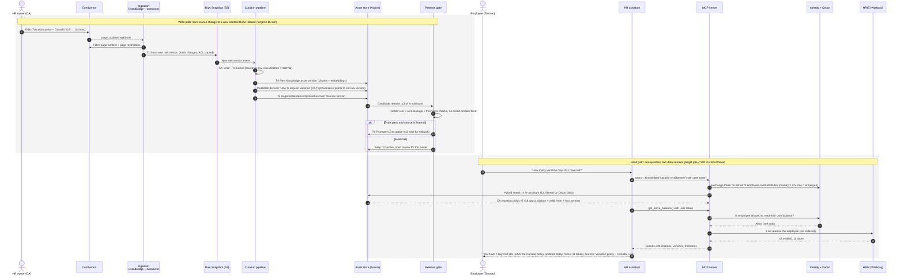
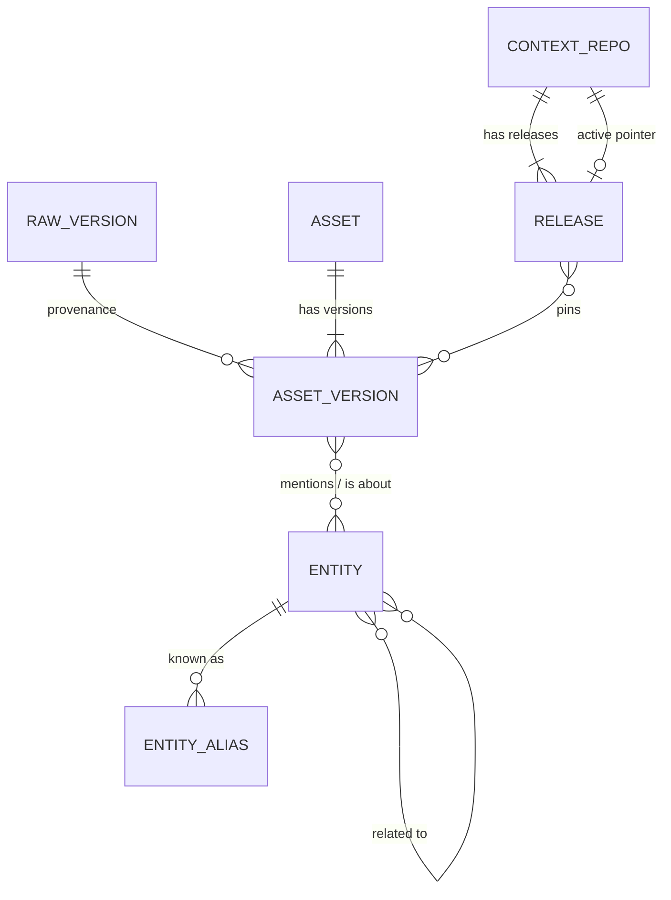
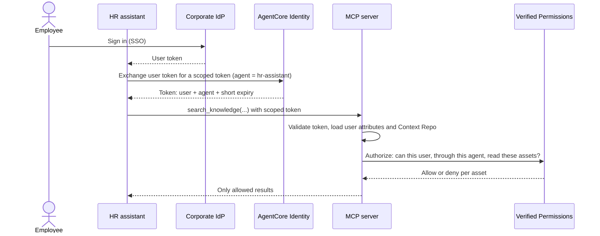
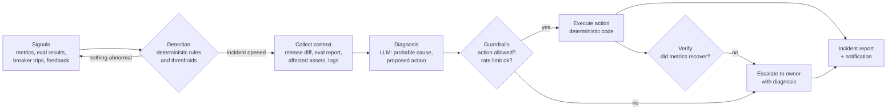

# Agent Knowledge Base: System Design

## Assumptions

None of these figures come from ShopFully or Flipp; they are plausible orders of magnitude.

- About 1,500 employees in 6 countries; content in Italian, English and other languages.
- 30–50 source systems (Confluence, SharePoint, Salesforce, Jira, Workday, NetSuite…), 2–5 million documents, 1–3% changing every day. 10–30 agents, about 50,000 questions a day.
- AWS is the cloud. A corporate identity provider (Okta or Entra ID) knows each employee's department, country and role.
- Every source has a named owner. Personal data stays in its region (GDPR, PIPEDA).
- Agents act for an identifiable person and only read from the knowledge base.
- A change reaches agents within 15 minutes when the source sends events, within 24 hours otherwise; a permission change within 5 minutes.

## 1. Architecture

Five layers, each with one job (Appendix A):

1. **Sources**: department systems. They remain the system of record; nothing is written back to them.
2. **Raw snapshot**: an exact, versioned copy of every source record with its access rules, used for citations, audit, rollback and reprocessing.
3. **Curated assets**: the units agents use. A pipeline splits documents into sections, tags them (owner, country, sensitivity, validity) and indexes them for search. An LLM also derives step-by-step procedures.
4. **Context Repos**: one per agent, listing the assets, tools and instructions it may use. Published in numbered releases, like software: a release goes live only if its tests pass, and can be rolled back.
5. **Access layer**: an MCP server that agents call on behalf of a signed-in user. It checks permissions and returns evidence.

Across all layers, **observability**: connectors, release tests and the MCP server send metrics and traces to CloudWatch. An observer agent watches them and, when something breaks, rolls back a release, quarantines a document or pauses a connector, and calls a human for anything else (Section 5, Appendix E).

Changes flow from source to snapshot, to assets, to a new release. Questions flow back: agent, MCP server, permission check, search in the agent's release, results with sources (Appendix B). Data that changes constantly or is personal (a leave balance, a salary) is not copied: it is read live from the source.

## 2. Data connection

- **One connector per source, the same three operations for all**: list what changed since a given time, fetch one record with its permissions, list every id that exists. Each connector turns its system's data into one common record format, so the rest of the pipeline never depends on the source.
- **Three ways to notice changes, because none is enough alone.** Sources that can send events (webhooks) report a change within seconds. Every source is also polled regularly for recent changes, which recovers lost events. A periodic full comparison of ids finds documents deleted without any notice.
- **Permissions are copied together with the content.** Every system describes permissions in its own way (Confluence spaces, SharePoint groups, Salesforce roles). For each source, a mapping approved by its owner translates them into a few common attributes: department, country, role, sensitivity. If a permission cannot be translated with certainty, only the owner sees the document until the mapping is fixed. This, not file formats, is the hardest part of connecting a source.
- **Each source is isolated.** Every connector has its own read-only account, queue and retries, so a source that fails never blocks the others.

## 3. Knowledge representation

- **Typed assets**: knowledge (a document section), procedure (steps derived by an LLM), tool (a live data source), example (a validated question and answer).
- **The same metadata on every asset**: owner, department, country, sensitivity, validity dates, and the exact source version it came from. Versions are never overwritten; when a source changes, procedures derived from it are regenerated.
- **Shared entities relate departments**: employee, team, country, product, customer, each with one system of record. "Product X" in Jira and in Salesforce is the same entity, so a roadmap agent can connect them. A few relational tables, not a full knowledge graph (Appendix C).
- **Two dates**: when a text changed, and when a rule applies. A policy valid from January is announced in November, not served as today's rule.
- **One scope per agent**: an HR assistant cannot reach Sales data, even if the user could. Less noise, less risk.

## 4. Agent access

- **MCP**, the standard most agent frameworks speak: search knowledge, get an asset, live tools (e.g. leave balance), context information.
- **Always on behalf of a user.** Every call carries a short-lived token naming the user and the agent (Appendix D). The agent never sees more than the user, nor more than its Context Repo.
- **Permissions checked twice on every request.** Cedar policies are applied as a filter inside the search, so forbidden content is never ranked, then checked again on each result. Highly sensitive content is also checked live against the source.
- **Evidence, not answers**: text, source and version, validity dates, freshness. When sources disagree, the agent gets both, with the most recent marked, and tells the user.
- **Prompt injection**: retrieved text is marked as data, never instructions. The main defence is authorization: a manipulated agent still cannot obtain what the user may not see.

## 5. Self-maintenance

| Change in a source | What happens |
|---|---|
| Deletion or permission change | Applied at once, to every version, without waiting for a release |
| Addition or edit | New version, published in the next release only if the tests pass |
| Source of a derived procedure changes | Procedure regenerated; for confidential topics its owner approves it |

- **Releases**: changes are grouped every few minutes per agent and promoted automatically if the tests pass; otherwise agents keep the previous release.
- **Circuit breakers** stop changes that look like failures (mass deletion, permissions suddenly widened, documents shrinking sharply): the source is frozen and its owner asked.
- **Observer agent** (Appendix E): rules detect problems, an LLM explains the cause. It can only roll back, quarantine a document or open a ticket, then checks that metrics recovered.

So "without manual intervention" holds for the normal case; anomalies and AI-written confidential content need a human.

## 6. Technology choices

Managed AWS services for infrastructure; own code where the value is (permissions, versions, release tests).

| Component | Choice and why | Excluded, and why |
|---|---|---|
| Change events | EventBridge, SQS FIFO: ordering per record, retries, serverless | Kafka / Kinesis: too heavy for ~100k changes a day |
| Connectors, pipeline | Lambda, ECS Fargate, Step Functions: visible state per document | Airflow: designed for nightly batch jobs, not thousands of small per-document runs; AppFlow: copies the data but not who may see it |
| Raw snapshot | S3 with versioning: cheap, durable, versioned | Raw content in the database: costly |
| Assets, versions, search | Aurora PostgreSQL with pgvector and full-text: permissions, versions and search in one query | OpenSearch: a second store to keep consistent (first option to scale search) |
| Embeddings, LLM | Bedrock (multilingual embeddings, Claude): data stays in the account and region | External APIs: one more data processor; self-hosting: GPU operations |
| Agent access | MCP server on AgentCore Runtime and Gateway: any framework can connect | Custom REST API: one adapter per framework |
| Identity, permissions | IdP with AgentCore Identity; Cedar in Verified Permissions: testable policies | Broad service accounts; OPA: no managed service |

**Build or buy?** Bedrock Knowledge Bases, Amazon Quick or Glean cover ingestion and search, but not versioning, release tests, per-agent scope or rollback. Building is the first decision to revisit with real requirements.

## 7. Trade-offs

- **Build vs buy**: control over accuracy, freshness and permissions, for months of engineering and a team to run it.
- **Copy vs live reads**: fast search even when a source is down, but the copy can be minutes old and must be protected.
- **One database**: permissions, versions and search always agree, because they live in the same place. The cost is search quality that is good but not the best available, and a limit of roughly 50 million text chunks before search must move to a dedicated engine.
- **Tests before publishing**: errors caught before users, for minutes of delay and a test set to maintain.
- **Deny by default**: no leak from mapping errors, but some documents are under-shared until fixed.

## 8. Quality evaluation

- **What**: accurate (right documents found, statements supported by the cited source), current (delay from change to visibility), authorized (zero leaks), plus unanswered questions, feedback, latency and cost.
- **Before every release**: golden questions with expected source and fact, leak probes per user profile, conflict and future-rule checks, document-collapse check. Any failure blocks the release.
- **In production**: test edits in each source measure the real delay; a daily sample of answers is scored by an LLM judge checked against humans; dashboards per source and agent; feedback linked to cited assets.
- **When problems arise**: a failing release is not published; a regression in production triggers a rollback; a leak is a security incident with quarantine; content gaps go to the owner. Every incident adds a test.

## Main risks

1. **Identity data is incomplete or wrong**: permissions depend on it, and fixing it is often organisational, not technical.
2. **A permission mapping error causes a leak**: mitigated by deny by default, owner-approved tests and the double check.
3. **Source owners do not engage**: their work must stay small and visible to department heads.
4. **Employee monitoring**: HR question logs are personal data; in Italy such tools need consultation with workers' representatives. Legal before launch.

## Appendix: diagrams

### A. System diagram

Components, how they interact, and the transformations applied to the data.

```mermaid
flowchart LR
  subgraph SRC["Department sources: owned and changed independently"]
    SRC1["People<br/>Workday / BambooHR<br/>REST API"]
    SRC2["Wiki<br/>Confluence / SharePoint<br/>API + webhooks"]
    SRC3["Sales<br/>Salesforce<br/>CDC events"]
    SRC4["Engineering<br/>Jira / GitHub<br/>webhooks"]
    SRC5["Finance<br/>NetSuite<br/>scheduled export"]
    SRC6["Public web / CMS<br/>crawler"]
  end

  subgraph ING["Ingestion: per region"]
    EVQ["EventBridge + SQS<br/>change events"]
    CON["Connectors<br/>Lambda / ECS tasks"]
    REC["Reconciler<br/>scheduled full diff"]
  end

  RAW[("Raw Snapshot<br/>S3 versioned + Object Lock<br/>object + source ACL + hash")]

  subgraph CUR["Curation pipeline: Step Functions"]
    T2["T2 Parse and normalize<br/>text, tables, sections"]
    T3["T3 Enrich metadata<br/>owner, ACL to Cedar attributes,<br/>jurisdiction, classification, PII"]
    T4["T4 Chunk and embed<br/>Bedrock embeddings"]
    T5["T5 Derive assets with LLM<br/>procedures, FAQs, entity links<br/>Claude on Bedrock"]
  end

  subgraph STORE["Knowledge store: Aurora PostgreSQL + pgvector"]
    AST[("Curated assets<br/>append-only versions<br/>+ provenance")]
    ENT[("Entity layer<br/>Employee, Team, Country,<br/>Product, Customer")]
    CTX[("Context Repos<br/>releases + active pointer")]
  end

  subgraph GATE["Release gate"]
    EVAL["Eval suite<br/>golden Q&A, ACL leakage,<br/>freshness"]
    CB["Circuit breakers<br/>mass delete, schema drift"]
  end

  subgraph ACC["Access layer: Bedrock AgentCore"]
    GW["MCP server<br/>AgentCore Gateway"]
    IDN["AgentCore Identity<br/>on-behalf-of token exchange"]
    AVP["Verified Permissions<br/>Cedar policies"]
    LIVE["Live tools<br/>volatile data, not indexed"]
  end

  IDP["Corporate IdP<br/>Okta / Entra"]

  subgraph AGT["AI agents"]
    AG1["HR assistant"]
    AG2["Roadmap agent"]
  end

  subgraph OPS["Observability and self-healing"]
    CW["CloudWatch + OpenTelemetry"]
    OBS["Observer agent<br/>detect, diagnose, act"]
    HUM["Human owners<br/>Slack / ticket"]
  end

  SRC2 & SRC3 & SRC4 -- "push events" --> EVQ
  EVQ --> CON
  SRC1 & SRC5 & SRC6 -- "incremental poll" --> CON
  CON -- "T1 snapshot + source ACL" --> RAW
  REC -. "missing ids become tombstones" .-> RAW
  RAW --> T2 --> T3 --> T4 --> AST
  T3 --> ENT
  AST --> T5 --> AST
  AST -- "candidate release" --> EVAL
  CB -. "blocks" .-> CTX
  EVAL -- "T6 promote if green" --> CTX
  CTX -. "pins asset versions" .-> AST

  AG1 & AG2 -- "MCP + user token" --> GW
  IDP --> IDN
  GW --> IDN
  GW -- "is this allowed?" --> AVP
  GW -- "T7 policy-filtered hybrid search" --> CTX
  GW --> LIVE
  LIVE -- "live lookup as the user" --> SRC1

  CON & EVAL & GW --> CW
  CW --> OBS
  OBS -- "rollback / quarantine" --> CTX
  OBS -. "pause" .-> CON
  OBS -- "escalate" --> HUM

  classDef src fill:#e8eef7,stroke:#4a6a9b,color:#1a1a1a
  classDef ing fill:#fdebd3,stroke:#c07a1e,color:#1a1a1a
  classDef raw fill:#fff4c2,stroke:#b39200,color:#1a1a1a
  classDef cur fill:#dcf1dc,stroke:#3d8b3d,color:#1a1a1a
  classDef store fill:#d5eeee,stroke:#2b7f7f,color:#1a1a1a
  classDef gate fill:#f9dada,stroke:#b03a3a,color:#1a1a1a
  classDef acc fill:#e9e0f5,stroke:#6a4a9b,color:#1a1a1a
  classDef agt fill:#d6e4ff,stroke:#2457c5,color:#1a1a1a
  classDef ops fill:#eeeeee,stroke:#666666,color:#1a1a1a
  class SRC1,SRC2,SRC3,SRC4,SRC5,SRC6 src
  class EVQ,CON,REC ing
  class RAW raw
  class T2,T3,T4,T5 cur
  class AST,ENT,CTX store
  class EVAL,CB gate
  class GW,IDN,AVP,LIVE,IDP acc
  class AG1,AG2 agt
  class CW,OBS,HUM ops
  style SRC fill:#f4f7fc,stroke:#4a6a9b
  style ING fill:#fef7ee,stroke:#c07a1e
  style CUR fill:#f1faf1,stroke:#3d8b3d
  style STORE fill:#eef8f8,stroke:#2b7f7f
  style GATE fill:#fdf0f0,stroke:#b03a3a
  style ACC fill:#f6f2fb,stroke:#6a4a9b
  style AGT fill:#eef3ff,stroke:#2457c5
  style OPS fill:#f7f7f7,stroke:#666666
```

### B. Data flow: a policy change and a question

The Canadian HR owner raises vacation from 15 to 18 days; an employee then asks how many days they have left.

### C. Data model

How assets, their versions, entities and Context Repo releases relate.

### D. Identity: on behalf of the user

How a user's identity reaches the knowledge base through the agent.

### E. Observer agent

Detect with rules, diagnose with an LLM, act only through allowlisted reversible actions.

