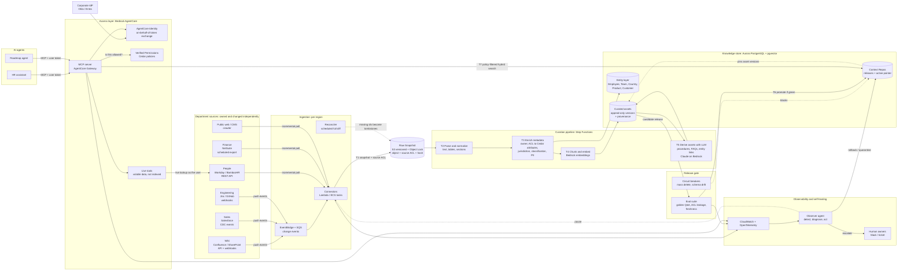
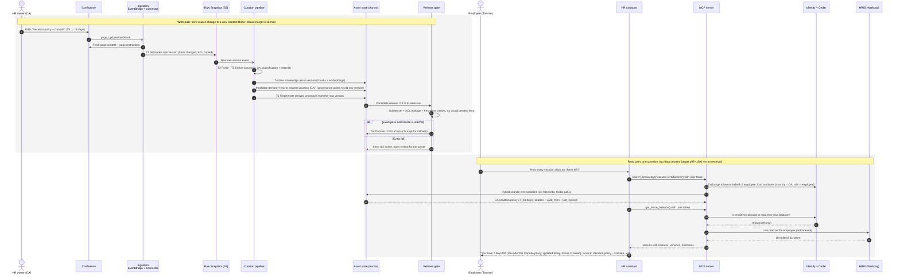

# Agent Knowledge Base: System Design

> Deliverable 1. This describes the **production** system at the scale and constraints of a global company. The POC in this repository deliberately covers a smaller scope; see [POC vs production](#12-poc-vs-production).

## 0. Executive summary

_TODO_

## 1. Problem framing and requirements

### 1.1 What "accurate, current, authorized" means operationally

The brief asks for knowledge that is accurate, current and authorized *at the moment the agent acts*. These words are only useful if they can be measured. This is how I define them:

| Property | Operational definition | How it is measured | Target (assumed) |
|---|---|---|---|
| **Accurate** | Every statement an agent receives is **faithful to a named source version**, and the agent can tell when sources disagree. | Citation precision on the golden set; share of answers with no citation; detected source conflicts. | ≥ 95% citation precision; 0 uncited factual answers in evals |
| **Current** | The time between a change in a source and its visibility to agents (**propagation lag**) stays within an agreed bound, per source class. Deletions count as changes. | Lag per source, measured end-to-end with synthetic canary edits. | ≤ 15 min for event-driven sources, ≤ 24 h for polled sources |
| **Authorized** | Access is decided **at query time**, for the **end user** the agent acts for, using the latest known permissions. Not at indexing time, and not with the agent's own rights. | ACL leakage tests (must be 0); lag of permission changes. | 0 leaks; permission changes effective ≤ 5 min, or checked live for sensitive data |

Two consequences shape the whole design:

- **Every answer carries its evidence.** Citation, source version and freshness are part of the response contract (§6), so the agent and the user can judge it, and so the evals can verify it.
- **Permissions are checked on every request, because the copy we store can be out of date.** When we sync a document, we also copy its permissions. That copy only reflects the moment of the sync: if permissions change in the source afterwards, trusting the copy could show a user a document they are no longer allowed to see. The design therefore (1) evaluates permissions on every request, for the specific user the agent acts for; (2) syncs permission changes with priority, to keep the copy at most a few minutes old; and (3) for the most sensitive content, checks access live against the source system before returning it (§6).

### 1.2 Questioning the requirements

Several parts of the brief look straightforward but hide a decision. I make each one explicit here, because they drive the architecture and are good starting points for discussion.

**"Maintains itself … without manual intervention."**
For content that is copied faithfully from a source, I agree: the source owner already approved it in their own system, so asking someone to review it again only adds delay. This does not hold for two cases:

- **Content derived by an LLM** (procedures, summaries, FAQs). This is new text that no source owner has approved. A fully automatic pipeline would publish model mistakes as if they were company knowledge.
- **Anomalies.** A connector bug or a permission change at the source can look like "half of the HR wiki was deleted". Applying that automatically is exactly the wrong reaction.

My interpretation: **no manual intervention in the normal case, explicit and minimal human involvement in the abnormal case.**

- **Derived content, gated by risk.** LLM-derived assets are published automatically only when the evaluation suite passes *and* their source is classified *internal* or lower. Derived assets from *confidential* or legal content (for example, disciplinary policies or contract terms) also require approval by the source owner. This costs a delay of hours for a small share of content, which is acceptable where a wrong answer has legal or personal consequences.
- **Anomalies trip circuit breakers.** For example, more than 20% of a source deleted in a single sync. The threshold is an assumption, to be calibrated per source on its historical change rate. The affected source is frozen at its last good state and the owner is asked to confirm (§7, §8).
- **Residual risk.** Evals only cover the questions in the golden set, so a derived asset can pass and still be wrong. This is mitigated by always citing the original source next to the derived asset, and by routing negative user feedback to the observer agent.

**"Transform that data into knowledge that AI agents can easily interpret."**
Not everything should be transformed and indexed. Two kinds of data are better left in the source and read live, through a tool:

- **Volatile data**, such as a remaining leave balance or an open opportunity's stage. An indexed copy would be stale by design.
- **Personal data**, such as salary or performance reviews. Copying it into a second store multiplies GDPR and PIPEDA exposure (retention, right to erasure, residency) for little benefit.

So the knowledge base exposes **both indexed knowledge and live tools** behind the same access layer. "Consistent access" means one interface (MCP) and one authorization model (Cedar), not one storage. The agent does not need to know whether an answer came from the index or from a live read.

What to index and what to read live is decided **per source, when its connector is onboarded**, by the source owner together with the knowledge base team, using four explicit criteria:

| Criterion | Favours indexing | Favours live reads |
|---|---|---|
| Change frequency | Changes rarely (policies, handbooks) | Changes continuously (balances, pipeline stages, ticket status) |
| Sensitivity | Internal or public | Personal or confidential (salary, health, performance) |
| Volume | Moderate, text-heavy | Very large, record-oriented |
| Typical question | "What is the rule / how do I…?" | "What is the value *now* for me / for this record?" |

For sensitive records a **hybrid pattern** applies: the index stores only *metadata* (that a record exists, its type, owner and subject) so that agents can find it, while its *content* is fetched live and authorized at read time. Personal data never enters the index or its embeddings.

Live reads have known costs. They add the latency of the source, mitigated with a short cache for non-critical data. When the source is down they return an explicit error rather than a stale value presented as current. Large aggregations over structured records are not retrieval at all: they belong to the data warehouse (see non-goals, §1.3).

**"Accurate."**
The system cannot make a wrong source right: if the handbook contains a mistake, the knowledge base will faithfully reproduce it. Promising accuracy in an absolute sense would be dishonest. What the system can guarantee is:

- **Fidelity.** It never states something the cited source version does not say. Every result carries its citation and version, and the evals measure citation precision.
- **Conflict detection.** For example, the handbook says 25 days of leave while the HRIS policy table says 22. Conflicts are searched only among assets about the same entity or topic (same policy, same country, overlapping validity), using the entity layer, and only those candidate pairs are compared by an LLM. Different values at different times are not a conflict: thanks to `valid_from` / `valid_to`, "25 days until 2025, 22 from 2026" is a timeline, and the version valid today is served.
- **Authority rules.** For each topic, the data owners declare which source wins (for example, "for leave entitlement, the HRIS overrides the handbook"). The knowledge base never invents authority. Rules start few and grow as real conflicts appear.
- **Transparent conflicts when no rule applies.** The agent receives both sources and tells the user that they disagree, **indicating which source is the most recent**, as a hint rather than a verdict: the newest document is not necessarily the correct one. A ticket is opened for the owners, so the source gets fixed. The knowledge base improves the quality of its sources without ever replacing them.

Conflict detection at scale is the most expensive and least mature part of this design; it is listed as a risk in §13.

**"A knowledge base."**
Shared knowledge, yes; shared context, no. Each agent needs a different, bounded subset. An HR assistant should not retrieve Sales pipeline data even if the user is allowed to see it:

- **noise**: irrelevant documents degrade retrieval and confuse the model;
- **risk**: an agent that can reach everything can leak anything, for example through a prompt injection hidden in a document from another domain;
- **cost**: more context means more tokens and more latency.

The design therefore separates:

- the **shared knowledge layer**: all curated assets, with their permissions, stored once;
- per-workflow **Context Repos**: a manifest of *references* to assets (not copies), plus instructions, tools and a version. For example, `hr-assistant` includes handbooks, benefits and the HRIS tool, and excludes Sales and Finance.

Two different rules decide what an agent sees, and it sees their **intersection**: the user's **permissions** (Cedar: what the user *may* see) and the Context Repo's **scope** (what is *relevant* to this agent). The scope is **strict**: an agent can never query outside it at runtime. If a use case needs more domains, its Context Repo is widened explicitly through a new, reviewable release, so every widening is a recorded decision rather than a runtime behaviour.

This also gives each agent its own evaluation suite, its own rollback unit, and an audit trail ("on 14 November the HR assistant answered using release r12, with these assets in these versions"). Context Repos are owned by the team building the agent; assets remain owned by the source owners.

**"Data from distributed sources … with different ownership."**
The hard part is not formats, it is **permission models**. Confluence uses spaces and page restrictions; Salesforce uses role hierarchies, sharing rules and territories; SharePoint and Drive use groups, folder inheritance and "anyone with the link"; Workday uses security groups tied to the org chart. Mapping all of them into one policy model is **lossy**: "a manager sees their reports' opportunities" depends on a hierarchy, not on a fixed attribute, and an organisation-wide sharing link matches no group at all.

How the design handles it:

- **A common model of attributes and relationships.** Cedar policies use attributes (department, country, role, classification) and relationships (for example, "user is manager of owner"), which covers the most common hierarchical cases.
- **A mapping per connector, validated with the source owner** at onboarding and covered by tests ("user X must see document A and must not see document B").
- **Deny by default when in doubt.** If a source permission cannot be translated with certainty, the document becomes visible **to its owner only**, and a ticket is opened to fix the mapping. Coverage is lost, security never is. The share of documents restricted this way is tracked as a metric and reduced over time.

Checking every source's own permissions on every query would be the most faithful option, but with 30–50 sources each search would fan out into dozens of calls: high latency, rate limits, and search failing whenever one source is down. Mapping errors remain a risk to validate with each source owner (§13), and the ACL leakage tests in the evaluation suite are the safety net.

### 1.3 Non-goals

- **Replacing the source systems.** Sources remain the system of record. The knowledge base never writes back to them.
- **Owning identity or permissions.** The corporate IdP owns identity, and the sources own their ACLs. The knowledge base copies and enforces them, it does not invent them.
- **Building the agents.** It serves any MCP-compatible agent. The HR assistant in the POC exists only to demonstrate the system.
- **Real-time analytics.** Aggregations across large numbers of structured records (for example, "revenue by region last quarter") belong in the data warehouse. Agents should reach it through a dedicated tool, not through retrieval.

## 2. Known vs. assumed

| Topic | Known (from the brief) | Assumed (by me) | Design impact if wrong |
|---|---|---|---|
| Company scale | Global, multi-department | ~1,500 employees, 6 countries (IT, ES, FR, CA, US, BR) | _TODO_ |
| Sources | Heterogeneous, independently owned | 30–50 systems (Confluence, SharePoint/Drive, Salesforce, Jira, Workday/BambooHR, NetSuite, Slack, internal DBs) | _TODO_ |
| Volume / churn | Continuous create/edit/delete | ~2–5M documents, 1–3% daily churn | _TODO_ |
| Freshness | Must be "current" | ≤15 min (event sources), ≤24 h (polled), ACL changes ≤5 min or live-checked | _TODO_ |
| Agent load | None of the agents exist yet | 10–30 workflows, ~50k queries/day, p95 retrieval < 800 ms | _TODO_ |
| Cloud | — | AWS | _TODO_ |
| Jurisdictions | Global | EU (GDPR) and Canada (PIPEDA) at minimum | _TODO_ |

## 3. Architecture

### 3.1 Layered model

The system is built as five layers. Each layer has a single responsibility and a clear owner of truth:

| Layer | Responsibility | Source of truth for |
|---|---|---|
| **Sources** | Department systems, owned and changed independently | The content itself |
| **Raw Snapshot** | Immutable, versioned copy of every source object, with its source ACL and a content hash | *What the source said, and when* (citations, audit, rollback) |
| **Curated Assets** | Typed, agent-ready units (Knowledge, Procedures, Tools, Examples, Memories) with mandatory metadata and provenance | *What an agent may use* |
| **Context Repo** | Per-workflow, versioned manifest: which assets, tools and instructions a workflow gets | *What a given agent sees, in which version* |
| **Access Layer** | MCP server acting on behalf of the end user, enforcing policy at retrieval time | *Who may see what, now* |

### 3.2 System diagram

### Transformations

| Step | Where | Input → Output | Why it exists |
|---|---|---|---|
| **T1** Snapshot | Connectors | Source object → raw object + source ACL + content hash + source version | Decouples us from source availability; gives an immutable base for citations, audit and rollback. Unchanged hash = no reprocessing. |
| **T2** Parse and normalize | Curation | PDF / HTML / JSON / wiki markup → a common document model (sections, tables, text) | Agents should not care about the source format. |
| **T3** Enrich metadata | Curation | Document → document + owner, department, Cedar attributes derived from the source ACL, jurisdiction, classification, PII tags; entity mentions → entity layer | Authorization and freshness rely on metadata. An asset without it is rejected, never indexed with defaults. |
| **T4** Chunk and embed | Curation | Document → *Knowledge* assets (section-aware chunks + embeddings + full-text index) | Retrieval units that stay faithful to the source and can be cited. |
| **T5** Derive with LLM | Curation | Knowledge assets → *Procedures*, FAQs, entity links, each pointing to the raw versions it came from | Agents act on steps, not prose. Provenance lets us invalidate a derived asset as soon as its source changes. |
| **T6** Promote | Release gate | Candidate assets → a new Context Repo release (only if evals pass and no circuit breaker fires) | "Current" without becoming "silently broken". |
| **T7** Serve | Access layer | User query + user identity → policy-filtered results, each with citation, version and freshness | "Authorized" is enforced on every call, not trusted to the agent. |

### 3.3 Data flow walkthrough

**Scenario.** The HR owner for Canada edits the leave policy in Confluence, raising vacation from 15 to 18 days. Shortly after, an employee in Toronto asks the HR assistant: *"How many vacation days do I have left?"*

The answer needs two different kinds of data: the **policy** (indexed knowledge, changed a minute ago) and the employee's **personal balance** (volatile and personal, read live from the HRIS).

**What each step demonstrates:**

| Steps | Requirement | What happens |
|---|---|---|
| 1–5 | *Current* | The change is pushed by a webhook, not discovered by a nightly job. The content hash changed, so the document is reprocessed; unchanged documents are skipped. |
| 3–4 | *Authorized* | The page restrictions are copied together with the content, in the same version. |
| 8–9 | *Accurate* | The procedure derived from the old version is invalidated through provenance, so the agent can never mix "15 days" from a stale summary with "18 days" from the new policy. |
| 10–13 | *Self-maintenance* | The new release is promoted automatically because the evals pass and the source is internal. Release r12 stays available for an instant rollback. |
| 15–18 | *Authorized* | The search runs on behalf of the employee: Canadian policies only, inside the HR assistant's scope only. |
| 19–23 | *Authorized + current* | The personal balance is never indexed. It is read live, and only the employee's own record is allowed. |
| 24–25 | *Accurate* | The answer carries the citation, version and freshness, so the user can verify it and the evals can measure it. |

**What if things go wrong along the way:**

- **The webhook is lost.** Incremental polling picks up the change within its interval, and the nightly reconciliation catches anything both missed. The freshness metric for Confluence-CA shows the delay.
- **The evals fail on r13.** The employee still gets an answer from r12, with the *old* policy and its date, which is clearly visible in the citation. The observer agent is notified (§8).
- **The HRIS is down.** `get_leave_balance` returns an explicit error. The agent can still answer the policy part ("you are entitled to 18 days") and say that it cannot read the balance right now, instead of guessing.
- **The employee asks between the edit and the promotion.** They get the previous version with its `last_synced` timestamp. This window is the propagation lag defined in §1.1.

## 4. Data connection

- Connector contract (events / incremental polling / full reconciliation)
- Handling formats, access methods and ownership
- Sources that block automated access

## 5. Knowledge representation

- Curated asset types: Knowledge, Procedures, Tools, Examples, Memories
- Mandatory metadata: owner, department, ACL, classification, jurisdiction, validity, version, provenance
- Entity layer (shared cross-department entities)
- Context Repos: per-workflow versioned manifests

## 6. Agent access

- MCP access layer and tool surface
- Identity: on-behalf-of, the agent never exceeds the user's permissions
- Authorization: Cedar policies, enforcement at retrieval time, live checks for sensitive data
- Citations, versions and freshness in every response

## 7. Self-maintenance

- Change propagation: additions, modifications, deletions (tombstones, grace period)
- Versioning and rollback
- Derived-asset invalidation via provenance
- Eval-gated promotion and circuit breakers
- Right to be forgotten

## 8. Observer agent

- Signals, deterministic detection, LLM diagnosis
- Allowlisted reversible actions, own identity, rate limits, escalation

## 9. Technology choices

| Component | Choice | Why | Alternatives excluded and why |
|---|---|---|---|
| _TODO_ | | | |

## 10. Trade-offs

## 11. Quality evaluation and monitoring

- Offline evals (golden set, ACL leakage, freshness)
- Online monitoring (sync lag, connector errors, uncited answers, feedback)
- Runbooks: what we do when problems arise

## 12. POC vs. production

## 13. Risks and open questions
