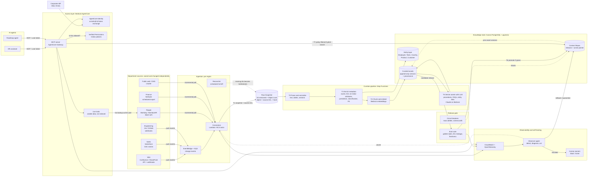

# Agent Knowledge Base: System Design

> Deliverable 1. This describes the **production** system at the scale and constraints of a global company. The POC in this repository deliberately covers a smaller scope; see [POC vs production](#12-poc-vs-production).

## 0. Executive summary

_TODO_

## 1. Problem framing and requirements

- 1.1 What "accurate, current, authorized" means operationally
- 1.2 Questioning the requirements (for example: "without manual intervention" vs. reviewable updates)
- 1.3 Non-goals

## 2. Known vs. assumed

| Topic | Known (from the brief) | Assumed (by me) | Design impact if wrong |
|---|---|---|---|
| Company scale | Global, multi-department | ~1,500 employees, 6 countries (IT, ES, FR, CA, US, BR) | _TODO_ |
| Sources | Heterogeneous, independently owned | 30–50 systems (Confluence, SharePoint/Drive, Salesforce, Jira, Workday/BambooHR, NetSuite, Slack, internal DBs) | _TODO_ |
| Volume / churn | Continuous create/edit/delete | ~2–5M documents, 1–3% daily churn | _TODO_ |
| Freshness | Must be "current" | ≤15 min (event sources), ≤24 h (polled), ACL changes ≤5 min or live-checked | _TODO_ |
| Agent load | None of the agents exist yet | 10–30 workflows, ~50k queries/day, p95 retrieval < 800 ms | _TODO_ |
| Cloud | — | AWS | _TODO_ |
| Jurisdictions | Global | EU (GDPR) and Canada (PIPEDA) at minimum | _TODO_ |

## 3. Architecture

### 3.1 Layered model

The system is built as five layers. Each layer has a single responsibility and a clear owner of truth:

| Layer | Responsibility | Source of truth for |
|---|---|---|
| **Sources** | Department systems, owned and changed independently | The content itself |
| **Raw Snapshot** | Immutable, versioned copy of every source object, with its source ACL and a content hash | *What the source said, and when* (citations, audit, rollback) |
| **Curated Assets** | Typed, agent-ready units (Knowledge, Procedures, Tools, Examples, Memories) with mandatory metadata and provenance | *What an agent may use* |
| **Context Repo** | Per-workflow, versioned manifest: which assets, tools and instructions a workflow gets | *What a given agent sees, in which version* |
| **Access Layer** | MCP server acting on behalf of the end user, enforcing policy at retrieval time | *Who may see what, now* |

### 3.2 System diagram

### Transformations

| Step | Where | Input → Output | Why it exists |
|---|---|---|---|
| **T1** Snapshot | Connectors | Source object → raw object + source ACL + content hash + source version | Decouples us from source availability; gives an immutable base for citations, audit and rollback. Unchanged hash = no reprocessing. |
| **T2** Parse and normalize | Curation | PDF / HTML / JSON / wiki markup → a common document model (sections, tables, text) | Agents should not care about the source format. |
| **T3** Enrich metadata | Curation | Document → document + owner, department, Cedar attributes derived from the source ACL, jurisdiction, classification, PII tags; entity mentions → entity layer | Authorization and freshness rely on metadata. An asset without it is rejected, never indexed with defaults. |
| **T4** Chunk and embed | Curation | Document → *Knowledge* assets (section-aware chunks + embeddings + full-text index) | Retrieval units that stay faithful to the source and can be cited. |
| **T5** Derive with LLM | Curation | Knowledge assets → *Procedures*, FAQs, entity links, each pointing to the raw versions it came from | Agents act on steps, not prose. Provenance lets us invalidate a derived asset as soon as its source changes. |
| **T6** Promote | Release gate | Candidate assets → a new Context Repo release (only if evals pass and no circuit breaker fires) | "Current" without becoming "silently broken". |
| **T7** Serve | Access layer | User query + user identity → policy-filtered results, each with citation, version and freshness | "Authorized" is enforced on every call, not trusted to the agent. |

### 3.3 Data flow walkthrough

_TODO: from a policy edit in a source to an agent answer_

## 4. Data connection

- Connector contract (events / incremental polling / full reconciliation)
- Handling formats, access methods and ownership
- Sources that block automated access

## 5. Knowledge representation

- Curated asset types: Knowledge, Procedures, Tools, Examples, Memories
- Mandatory metadata: owner, department, ACL, classification, jurisdiction, validity, version, provenance
- Entity layer (shared cross-department entities)
- Context Repos: per-workflow versioned manifests

## 6. Agent access

- MCP access layer and tool surface
- Identity: on-behalf-of, the agent never exceeds the user's permissions
- Authorization: Cedar policies, enforcement at retrieval time, live checks for sensitive data
- Citations, versions and freshness in every response

## 7. Self-maintenance

- Change propagation: additions, modifications, deletions (tombstones, grace period)
- Versioning and rollback
- Derived-asset invalidation via provenance
- Eval-gated promotion and circuit breakers
- Right to be forgotten

## 8. Observer agent

- Signals, deterministic detection, LLM diagnosis
- Allowlisted reversible actions, own identity, rate limits, escalation

## 9. Technology choices

| Component | Choice | Why | Alternatives excluded and why |
|---|---|---|---|
| _TODO_ | | | |

## 10. Trade-offs

## 11. Quality evaluation and monitoring

- Offline evals (golden set, ACL leakage, freshness)
- Online monitoring (sync lag, connector errors, uncited answers, feedback)
- Runbooks: what we do when problems arise

## 12. POC vs. production

## 13. Risks and open questions
